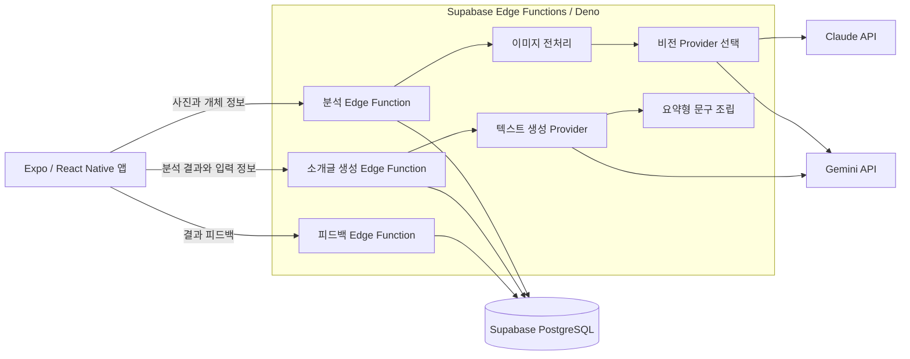

# 모프모야

> 크레스티드 게코 사진으로 모프를 추정하고, 분양 소개글 작성을 돕는 AI 앱

크레스티드 게코를 기르는 사람이 개체의 특징을 설명하고 소개글을 쓰는 과정을 돕습니다. 사진을 기반으로 모프를 추정하고, 사용자가 입력한 개체 정보를 더해 분양 게시글에 쓸 문구를 만듭니다.

이 저장소는 프로젝트 소개를 위한 공개 포트폴리오입니다. 서비스 소스 코드는 비공개로 관리합니다.

## 프로젝트 개요

| 항목 | 내용 |
| --- | --- |
| 개발 기간 | 2026.08 ~ 진행 중 |
| 개발 형태 | 1인 풀스택 개발 |
| 주제 | 이미지 기반 모프 추정, AI 소개글 생성 |
| 주요 기술 | TypeScript, Expo, React Native, Supabase Edge Functions, PostgreSQL, Claude API, Gemini API |

## 만들게 된 이유

개체를 소개하려면 색상과 패턴 등 특징을 설명할 수 있어야 합니다. 모프에 익숙하지 않은 사육자도 사진과 기본 정보를 통해 소개 문구를 작성할 수 있도록 만들고 있습니다.

## 주요 기능

- **사진 기반 모프 추정:** 크레스티드 게코 사진을 바탕으로 모프와 특징을 추정합니다.
- **소개글 생성:** 이름, 성별, 가격 등 입력한 개체 정보를 반영해 분양 게시글용 문구를 생성합니다.

## 개선한 점

### 라벨링 평가셋을 통한 판별 품질 개선

라벨링 평가셋을 기준으로 모프 판별 정확도를 **33%에서 60%로 개선**했습니다.

이 수치는 해당 평가셋에서 측정한 결과이며, 모든 개체나 촬영 환경에서의 정확도를 뜻하지 않습니다. 사진으로 추정하는 기능이므로 유전 정보를 확정하는 검사와는 구분합니다.

### 소개글 생성 응답 시간 개선

분양글 생성 응답 시간을 **33초에서 3.5초로 단축**했습니다.

수치와 진행 상태는 2026.11.02 이력서 기준입니다. 평가셋 규모와 응답 시간 측정 조건은 공개 자료를 정리한 뒤 보완할 예정입니다.

## 담당 범위

기획부터 앱과 백엔드 구현, AI 기능 연동 및 개선까지 혼자 진행하고 있습니다.

## 백엔드 아키텍처

사진 분석, 소개글 생성, 피드백 수집을 각각 Edge Function으로 분리했습니다. 분석 요청은 이미지 전처리를 거쳐 비전 모델에 전달하고, 소개글 생성은 분석 결과와 사용자가 입력한 개체 정보를 받아 별도로 처리합니다. PostgreSQL은 사용량, 생성 횟수 제한, 결과 피드백을 관리합니다.

### 설계에서 신경 쓴 점

- **AI 호출부 분리:** 사진 분석은 Claude 또는 Gemini를 선택할 수 있도록 Provider 경계를 두었습니다. 소개글 생성은 별도 설정으로 Gemini를 사용합니다.
- **분석과 문구 생성 분리:** 작업 성격에 맞게 모델을 선택하고 각각 개선할 수 있도록 구성했습니다.
- **전처리와 응답 조립:** 사진은 모델 호출 전에 전처리하고, 소개글의 요약형은 구조화된 입력으로 직접 조립합니다.
- **평가와 피드백:** 라벨링 평가셋으로 판별 결과를 비교하고, 앱에서 받은 피드백은 별도 경로로 저장합니다.

그림은 현재 로컬 구현의 주요 구성입니다. 실제 배포의 Provider 설정값을 단정하지 않으며, 운영 주소와 비공개 저장소 링크는 포함하지 않습니다.

## 개발 상태

개발을 진행하고 있습니다. 공개 가능한 화면과 사용 흐름은 준비되는 대로 이 문서에 추가할 예정입니다.

## Developer

[장하늬](https://github.com/hany0147) / 기획 및 풀스택 개발
